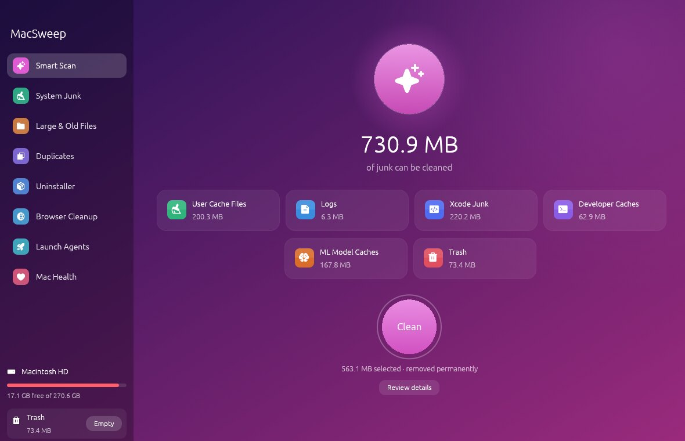
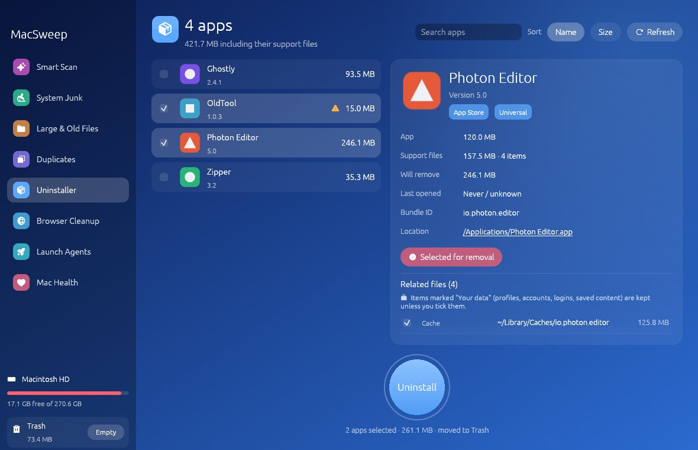
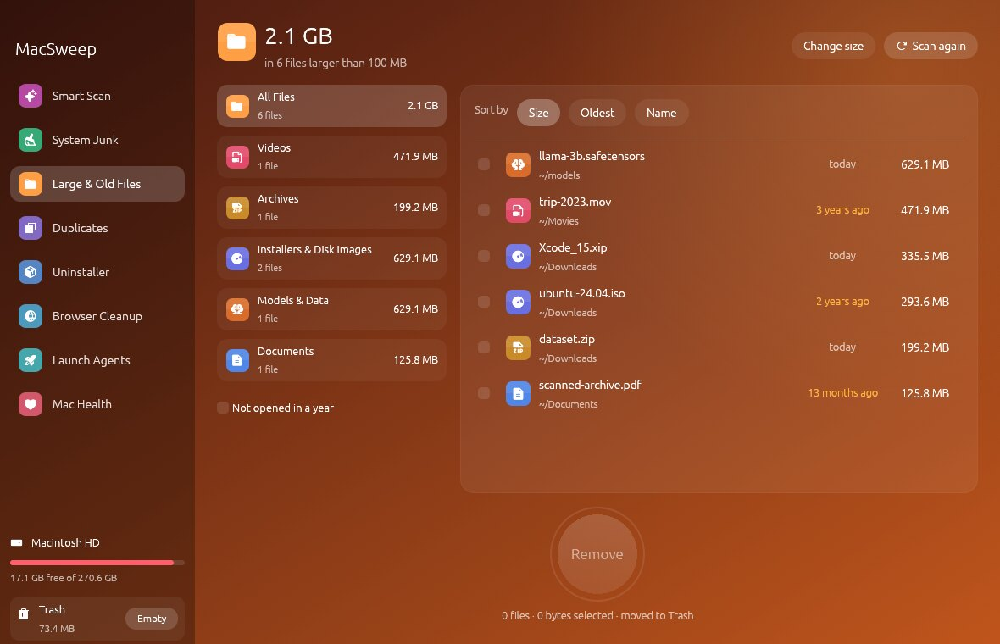
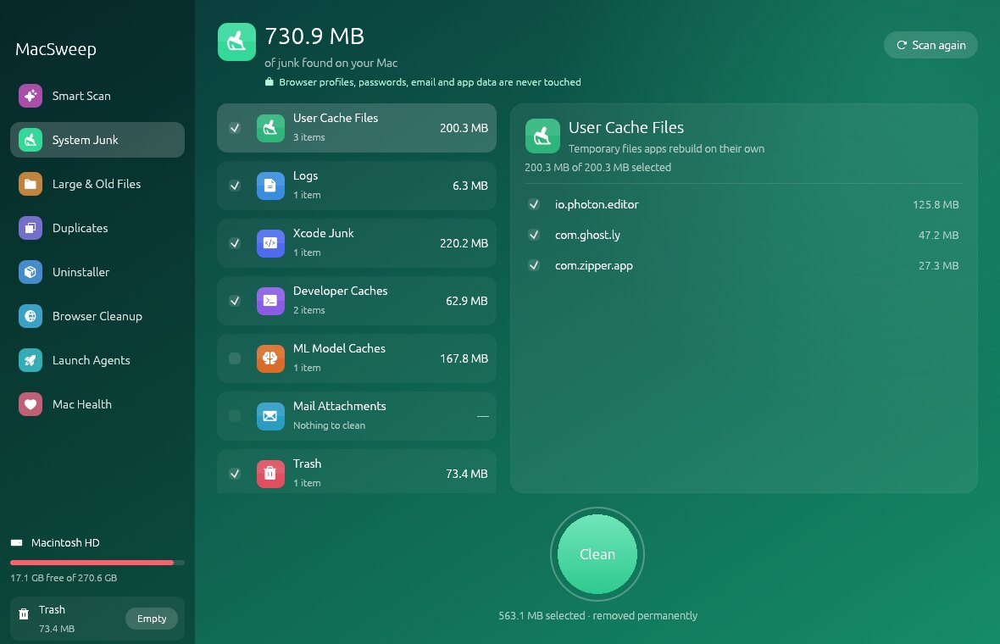
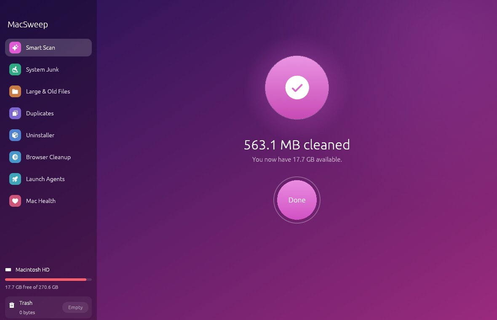
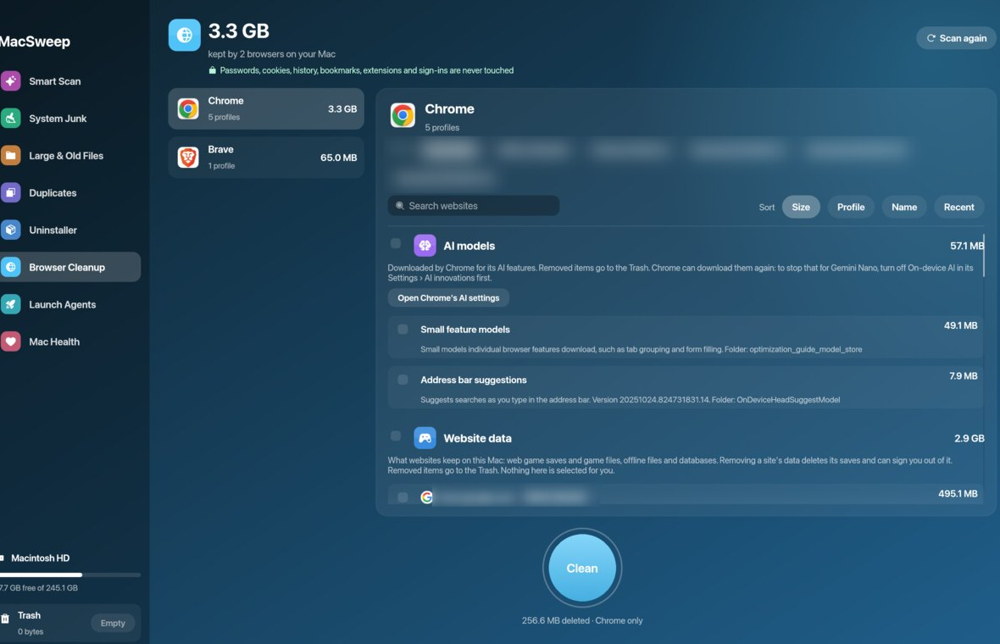
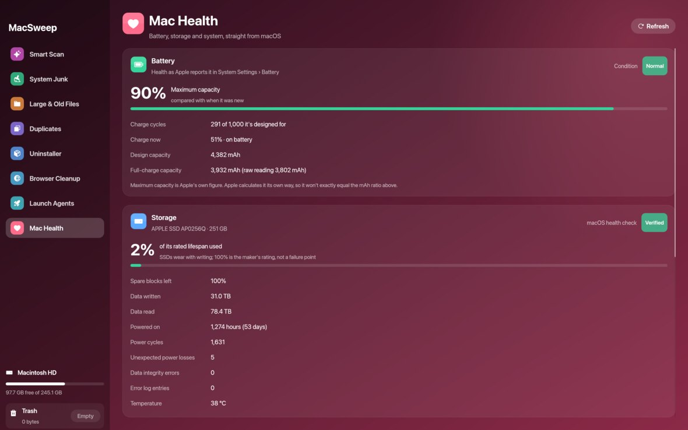

<div align="center">


# MacSweep

**A free, open-source Mac cleaner written in Rust.**
Clean junk, find big forgotten files and duplicates, fully uninstall apps, clean each browser site by site, and check your battery and SSD health, all from one small native app.

[](https://github.com/nihal4/macsweep/releases/latest)
[](https://github.com/nihal4/macsweep/actions/workflows/ci.yml)
[](LICENSE)




[**⬇ Download MacSweep**](https://github.com/nihal4/macsweep/releases/latest) · [Website](https://macsweep-app.netlify.app/) · [Report a bug](https://github.com/nihal4/macsweep/issues/new?template=bug_report.md) · [Request a feature](https://github.com/nihal4/macsweep/issues/new?template=feature_request.md)

</div>

---

## Why MacSweep?

- **Free and open source.** No subscription, no ads, no "upgrade to clean" paywall. Every line is right here.
- **Safe by design.** It never touches your passwords, cookies, browser history, email or app data, and only removes a website's data if you tick that site (see [Safety](#safety--your-data-is-never-touched)).
- **Tiny and fast.** A native Rust app: a 7 MB download that runs on both Apple Silicon and Intel (6.6 MB if built for Apple Silicon only). It uses macOS's own fonts instead of bundling them. Scans use every CPU core, and nothing runs in the background unless you turn on the menu bar monitor.
- **Private.** No accounts, no telemetry. Everything happens on your Mac. The only network request is one check at launch asking GitHub whether a newer version exists; nothing about you or your Mac is sent. To turn it off, create an empty file at `~/Library/Application Support/MacSweep/no-update-check`.

## Features

| | |
|---|---|
| ✨ **Smart Scan** | One click finds caches, logs, build leftovers and Trash, and shows a summary by category. |
| 🧹 **System Junk** | Review every category and file before cleaning, with per-file checkboxes. Developer (Xcode, npm, Gradle) and ML-model caches (Hugging Face, PyTorch) are included. |
| 📁 **Large & Old Files** | Finds big files in your home folder, grouped by kind (videos, archives, installers, models & data…), with a "not opened in a year" filter. |
| 🗂️ **Duplicates** | Finds exact duplicate files (same size and same BLAKE3 content hash) in Desktop, Documents, Downloads, Pictures, Movies and Music. Always keeps at least one copy, never looks inside Photos/Music libraries or app data, and moves extras to the Trash. |
| 📦 **Uninstaller** | Every app with its icon, version, App Store / Apple Silicon / Intel badges, last-opened date and **true size including leftovers**. Select several apps at once. |
| 🌐 **Browser Cleanup** | For Chrome, Brave, Edge, Arc, Vivaldi, Opera and Chromium: the AI models each browser downloaded (like Chrome's Gemini Nano), website data per site and profile (where **web games keep their saves**, never ticked for you) and cache. Filter by profile, search and sort. Passwords, cookies, history, bookmarks and sign-ins are never touched. |
| 🚀 **Launch Agents** | Lists background helpers and flags **orphaned** ones whose app is already gone. |
| ❤️ **Mac Health** | Battery health (Apple's own Maximum Capacity and Condition, cycle count), SSD health (lifespan used, spare blocks, data written, errors) and system details. Every value comes from macOS itself and is [validated against Apple's tools](docs/health-validation.md). |
| 📊 **Menu bar monitor** | Optional and off by default: live CPU, memory and free disk space in the menu bar, from a separate tiny helper. [Measured cost](CHANGELOG.md#v030): 2.2% of one core at live updates, 0.5% at every 5 s. |
| 🔔 **Update notice** | When a new version is published, the sidebar tells you and links to it. One request to GitHub at launch; nothing about you is sent. |
| 💾 **Live disk & Trash** | The sidebar always shows free space and Trash size, updates instantly after every clean, and has a one-click **Empty Trash**. |

<table>
<tr>
<td></td>
<td></td>
</tr>
<tr>
<td></td>
<td></td>
</tr>
<tr>
<td></td>
<td></td>
</tr>
</table>

## How MacSweep compares

| | MacSweep | Mole (CLI) | Mole for Mac | CleanMyMac |
|---|---|---|---|---|
| Price | **Free** | Free | Paid, one-time | Paid |
| Interface | **Graphical app** | Terminal | Graphical app | Graphical app |
| Open source | **Yes, MIT** | Yes, GPL-3.0 | No | No |
| Oldest macOS | **macOS 11** | see project | macOS 14 | see vendor |

[Mole](https://github.com/tw93/Mole) is a far more mature project with many more features. If you're comfortable in Terminal, it's a great choice. MacSweep is for people who want a free graphical app with a strict, tested promise about their data.

> **Not to be confused with** other, unrelated projects also named MacSweep. This is the Rust app by [nihal4](https://github.com/nihal4), at [macsweep-app.netlify.app](https://macsweep-app.netlify.app/).

## Install

1. Download **`MacSweep-x.y.z.zip`** from [Releases](https://github.com/nihal4/macsweep/releases/latest), unzip it, and move **MacSweep** to **Applications**.
2. MacSweep isn't notarized by Apple yet (that needs a paid developer account), so macOS blocks it the first time. Either:
   - Open it once, click **Done**, then go to **System Settings → Privacy & Security**, scroll down and click **Open Anyway** (macOS 15 Sequoia and later; on older macOS you can right-click the app → **Open**), or
   - run this once in Terminal:
   ```bash
   xattr -dr com.apple.quarantine /Applications/MacSweep.app
   ```
3. Turn on **System Settings → Privacy & Security → Full Disk Access** for MacSweep, then reopen it (or click **Relaunch** in the sidebar).
4. The first time you remove something, allow MacSweep to control **Finder**. It uses Finder to move files to the Trash, so **Put Back** works.

<details>
<summary><b>Full Disk Access still shows as off?</b></summary>

1. In System Settings → Full Disk Access, select MacSweep, click **–** to remove it, then **+** to add `/Applications/MacSweep.app` again.
2. Quit and reopen MacSweep. macOS only applies the permission to a freshly started app.
3. Open the app from Applications, not by running the binary in Terminal. From Terminal, the permission belongs to Terminal instead.
</details>

## Updating

When a new version is out, MacSweep shows it in the sidebar (from v0.3.0 on; older versions can't). To update:

1. Download the new zip from [Releases](https://github.com/nihal4/macsweep/releases/latest), unzip it, quit MacSweep, and replace the copy in **Applications**.
2. **Turn Full Disk Access on again.** Releases aren't signed with an Apple developer certificate yet, so macOS treats each new version as a new app: in System Settings → Privacy & Security → Full Disk Access, remove MacSweep with **–**, add it again with **+**, and reopen it.
3. If you use the menu bar monitor, it switches to the new version by itself.

## Safety — your data is never touched

Some cleaners have wiped people's browser profiles and email. MacSweep is built so that **can't happen**:

- **Allowlist, not blocklist.** Junk cleaning can only delete *inside* a fixed list of cache, log and build folders (`JUNK_ROOTS` in [`src/fsutil.rs`](src/fsutil.rs)). Every path is checked again right before deletion.
- **Never touched by junk cleaning:** browser profiles (Chrome, Brave, Firefox, Safari: history, passwords, bookmarks, logins), Mail, Messages, Keychains, cookies, app containers, `~/Library/Application Support`, and your documents. For browsers, only the disposable download cache is cleaned.
- **Browser Cleanup only removes what you tick.** It can remove a browser's AI models, cache, and a website's stored data (its databases, offline files and file storage, where web games keep saves), but website data is never ticked for you and goes to the Trash. Passwords, cookies, history, bookmarks, extensions' data and Local Storage (where sign-ins live) are never listed and can't be removed: an allowlist refuses any other folder. A browser that is open is never cleaned.
- **Sign-in and sync caches are skipped:** iCloud, CloudKit, Apple ID, Wallet, Family, and anything named like a password manager, token, auth, account or login.
- **The Uninstaller keeps your data unless you ask.** Leftovers are split into *safe to remove* (cache, logs, preferences, window state) and **Your data** (profiles, containers, cookies, web storage), which is never pre-selected.
- **Recoverable by default.** Apps, large files, launch agents, and browsers' AI models and website data go to the Trash. Only junk and browser cache are deleted permanently, after you click Clean.
- Apple's own apps are never listed in the Uninstaller.
- Automated tests (`cargo test`) check that browser profiles, Mail, keychains, cookies, Documents and `../` path tricks can never be deleted by junk cleaning, and that Browser Cleanup refuses passwords, cookies, Local Storage, extensions' data and the profile itself.

## Build from source

The fork includes a shared Xcode scheme, safety checks, and Developer ID signing instructions. See [the fork project notes](PROJECT.md).

```bash
curl --proto '=https' --tlsv1.2 -sSf https://sh.rustup.rs | sh   # one-time Rust install
git clone https://github.com/nihal4/macsweep && cd macsweep
./scripts/setup-signing.sh  # optional, once: keeps Full Disk Access across rebuilds
./bundle.sh                 # dist/MacSweep.app for this Mac
UNIVERSAL=1 ./bundle.sh     # Apple Silicon + Intel in one app
```

## Roadmap

- [x] Duplicate file finder (v0.2)
- [x] Menu-bar mini monitor (disk, RAM, CPU) (v0.3)
- [x] Mac Health: battery, SSD and system health (v0.3)
- [x] Browser Cleanup: AI models, website data and cache per browser and profile (v0.3)
- [ ] Firefox and Safari in Browser Cleanup
- [ ] Scheduled scans and reminders
- [ ] Homebrew install (`brew install --cask macsweep`)
- [ ] Notarized builds

Ideas are welcome: [open a feature request](https://github.com/nihal4/macsweep/issues/new?template=feature_request.md).

## Contributing

Pull requests are welcome! Please read [CONTRIBUTING.md](CONTRIBUTING.md). The one hard rule: **never widen what can be deleted without a test that proves user data stays safe.**

## How it's built

- [Rust](https://www.rust-lang.org) with [egui](https://github.com/emilk/egui) (OpenGL), with no web view inside
- [`jwalk`](https://crates.io/crates/jwalk) + [`rayon`](https://crates.io/crates/rayon) for parallel scanning
- [`trash`](https://crates.io/crates/trash) for Finder-compatible Trash, [`icns`](https://crates.io/crates/icns) for app icons, [`plist`](https://crates.io/crates/plist) for app metadata
- No bundled text fonts: San Francisco and the Mac's own fallback fonts are memory-mapped from disk; the icon font holds only the icons used
- The menu bar monitor is a separate tiny native app (AppKit through [`objc2`](https://crates.io/crates/objc2)), so MacSweep itself doesn't stay open
- Browser Cleanup reads Chrome's own indexes with a small read-only LevelDB reader, and website icons from the browser's icon database with a bundled, patched SQLite

Releases are built by GitHub Actions: push a tag such as `v0.3.0` and a universal `.app` is attached to a new release, with notes taken from [CHANGELOG.md](CHANGELOG.md).

## License

[MIT](LICENSE) © S. M. Nihal Ahmed. Icons by [Phosphor](https://phosphoricons.com) (MIT).

If MacSweep saved you some space, please **⭐ star the repo**. It helps other people find it.
